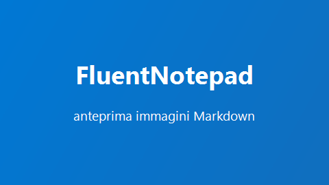

# Guida di prova

Benvenuto in **FluentNotepad** con *anteprima Markdown*! Visita [Microsoft](https://www.microsoft.com) oppure <https://dotnet.microsoft.com>.

## Formattazione

Testo con `codice inline`, **grassetto**, *corsivo* e ~~barrato~~. Escape: \*non corsivo\*.

> Una citazione elegante
> su due righe.

---

### Liste

- Mele
- Pere
  - Sotto-voce annidata
  - Altra voce
- [ ] da fare
- [x] fatto

1. Primo passo
2. Secondo passo
10. Numerazione personalizzata

### Codice

```csharp
var x = 42;
Console.WriteLine($"Valore: {x}");
```

| Nome  | Età | Città  |
|:------|----:|:------:|
| Anna  |  28 | Roma   |
| Marco |  35 | Milano |

## Immagini

Percorso relativo alla cartella del file:



Stessa immagine in linea:  con testo attorno.

Con query string (es. `?raw=true` di GitHub) o frammenti (`#center`):


File inesistente (mostra un segnaposto elegante):


Titolo Setext
=============

Sottotitolo
-----------
