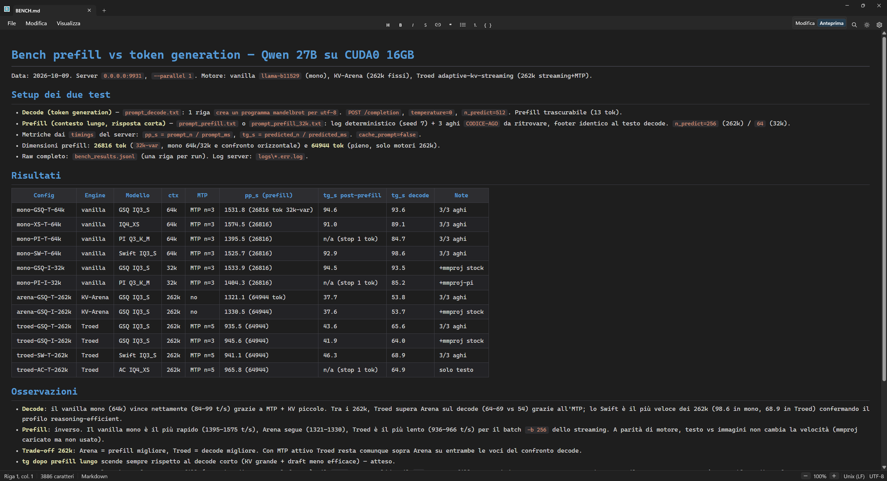
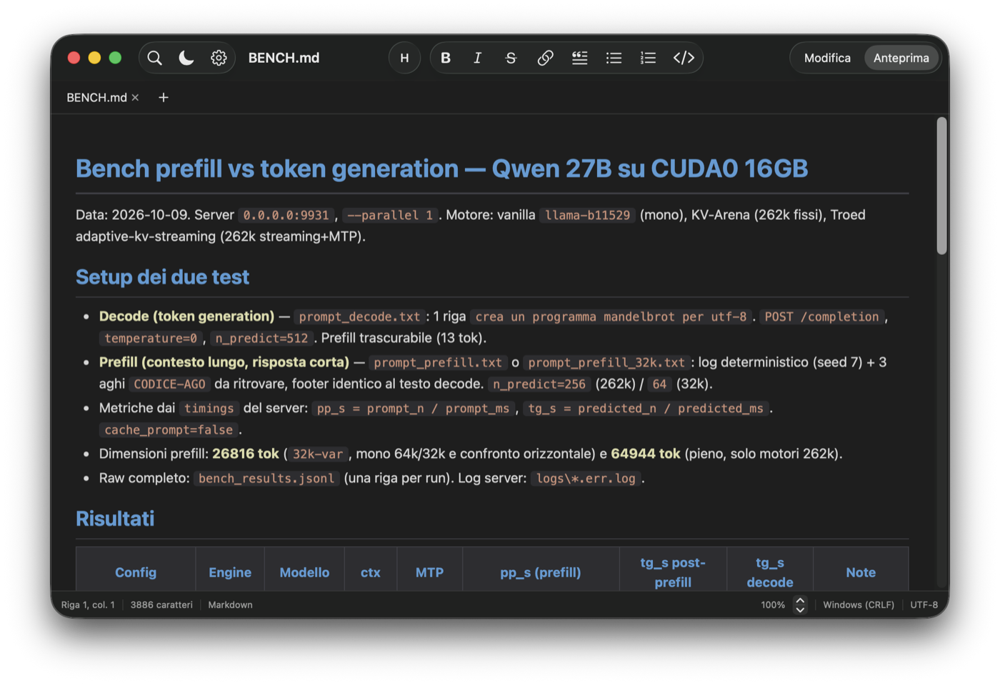

# FluentNotepad

A native Notepad-style editor with built-in Markdown preview — two builds
from one repo, same features on both platforms.

## Features (both platforms)

Same intents on both platforms — see the parity checklist in [AGENTS.md](AGENTS.md).

## Requirements

- Windows 10 1809+ (Mica on Windows 11) + WebView2 evergreen (preinstalled on Windows 11). To build: .NET 8 SDK.
- macOS 14+, Apple Silicon. To build: Swift 6 toolchain.

## Download

The repo contains sources only (builds and setups are **not** versioned). Same
version number = same features on both platforms (see Changelogs below).

- **Windows**: [Releases](../../releases) page → `FluentNotepad-Setup-2.9.5-win-x64.exe` (per-machine install in Program Files, optional file associations)
- **macOS**: [Releases](../../releases) page → `FluentNotepad.dmg` from a `macos-vX.Y.Z` release → drag `FluentNotepad.app` into Applications. First launch: right-click → Open (ad-hoc signature).

Or build it yourself: see `windows/AGENTS.md` (Build/run) and `macos/AGENTS.md` (Build/run).

## Changelog

Same version number = same features everywhere. Windows is at `2.9.5`, macOS at `2.7.0` (JSON/XML previews pending there).

- **2.9.5** (Windows) — Click-to-source flashes the target line (it used to select-and-abort before painting).
- **2.9.4** (Windows) — Caret-line flash (two blinks) when entering Edit mode.
- **2.9.3** (Windows) — Version info lives only in Help > About now, removed from Settings (both platforms).
- **2.9.2** (Windows) — Help > About dialog (macOS uses the native app-menu About).
- **2.9.0** (Windows) — XML tree preview: `.xml`/`.config` files open in a collapsible tree on the same schema (attributes as `@name` rows, XPath copy paths, XML comments shown, invalid-XML error with line/column, XML highlighting in edit mode). JSONC comments now shown in the JSON tree. Fixed a startup crash when opening tree-preview files (no RichEdit formatting inside the layout pass) and the Release publish missing the app `.pri`/`.xbf` (installed app died on launch). Per-machine install now targets the real Program Files on 64-bit.
- **2.8.0** — never published (local only).
Last 5 entries; full history in [Releases](../../releases) and the Done section
of [TODO.md](TODO.md) (archived at each release).

## License

MIT — see [LICENSE](LICENSE).
