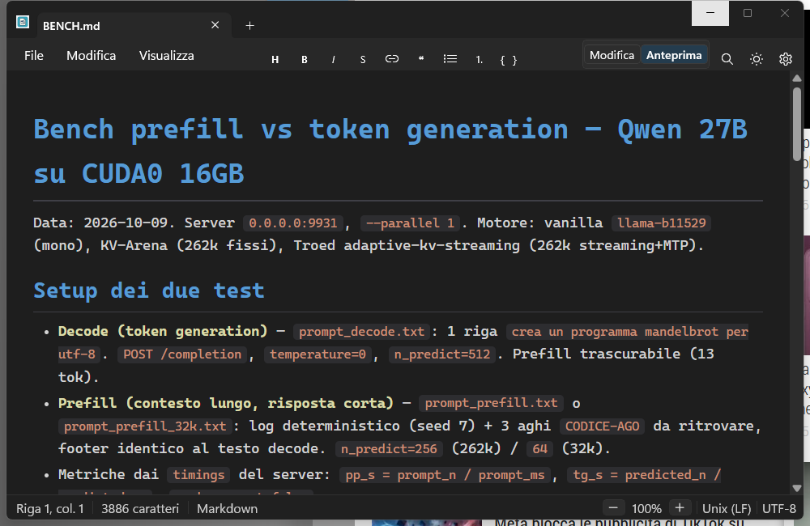

# FluentNotepad

A Windows 11 Notepad clone in WinUI 3, with built-in Markdown preview.



## Features

- Drag-reorderable **tabs**, `+` for a new tab, `*` for unsaved changes
- **Markdown preview** (WebView2 + Markdig): tables, task lists, code, quotes, links, local/remote/data-URI/SVG images — `.md` files open directly in Preview
- **Visual Studio-style colors** for headings, links, code, bold/italic, quotes and tables (light and dark themes), in Preview and in edit mode (live syntax highlighting while typing)
- **Formatting toolbar** (heading, bold, italic, strikethrough, link, quotes, lists, code)
- System **Mica**, extended title bar with tabs inside, Edit/Preview toggle (Ctrl+Shift+V)
- Find (Ctrl+F), zoom, word wrap, file drag & drop (including onto the preview), **ESC** toggles Edit/Preview
- Multiple independent **windows** (File → New window, Ctrl+Shift+N)
- Print (Ctrl+P) of the rendered Markdown preview in color, always with the light theme on paper (WebView2 print dialog)
- Status bar like the original (line/column, characters, file type, zoom, CRLF/LF, UTF-8)
- Interface in **English and Italian** (follows the Windows display language)

## Requirements

- Windows 10 1809+ (Mica on Windows 11)
- WebView2 evergreen (preinstalled on Windows 11)
- To build: .NET 8 SDK

## Download

The repo contains sources only (builds and setup are **not** versioned). Two options:

- **Ready-made setup**: [Releases](../../releases) page → `FluentNotepad-Setup-2.4.1-win-x64.exe` (per-machine install in Program Files, optional `.md` association)
- **Build it yourself**:

```bash
dotnet publish source\FluentNotepad.WinUI.csproj -c Release -p:Platform=x64
iscc installer\FluentNotepad.iss
```

The installer lands in `installer\dist\` (requires Inno Setup 6).

## Try without installing

```bash
# double-click start-debug.bat, or:
dotnet build source\FluentNotepad.WinUI.csproj -c Debug
```

## Structure

- `source/` — source code (WinUI 3, .NET 8): `MainWindow.*` (shell, tabs, editor, themes), `MarkdownHtml.cs` (Markdown → HTML), `MarkdownHighlight.cs` (edit-mode colors), `CursorGrid.cs`, `Assets/`, `Properties/`, `Strings/` (EN/IT UI resources)
- `installer/` — Inno Setup 6 script (per-machine install in Program Files, optional `.md` association)
- `app/` — ready-to-run published build (**not versioned**, see `.gitignore`)
- `BENCH.md` — sample file to try the preview (tables included)
- `screenshot-dark.png` — the BENCH.md preview shown above

Technical details (in Italian) in [`source/README.md`](source/README.md).

## Changelog

- **2.4.1** — Fixed edit-mode highlighting not rendering on file open (repaint on editor load) and black bars behind text (opaque editor background instead of transparent).
- **2.4.0** — Multiple windows (File → New window, Ctrl+Shift+N, cascaded); ESC toggles Edit/Preview on Markdown docs; files dropped onto the preview open as tabs instead of navigating away (all like FluentNotepadMac).
- **2.3.0** — Syntax highlighting in edit mode for Markdown files (same VS-style colors as the preview, like FluentNotepadMac), applied live while typing.
- **2.2.2** — Fixed Markdown tables with `$` in cells (single-dollar math merged cells across `|`); dollars now stay literal.
- **2.2.1** — Fixed printing from dark mode (page no longer gets a dark frame) and the print header now shows the file name instead of `about:blank`.
- **2.2.0** — File → Print (Ctrl+P): prints the rendered Markdown preview in color via WebView2 (browser print dialog), always with the light theme on paper; plain text shows an info message.
- **2.1.1** — Fixed spurious `Ctrl++` tooltip over the editor (accelerator display hidden, shortcuts unchanged); fixed window geometry not being restored (settings JSON casing mismatch).
- **2.1.0** — Window remembers position, size and maximized state; renamed `avvia-debug.bat` → `start-debug.bat`.

## License

MIT — see [LICENSE](LICENSE).
